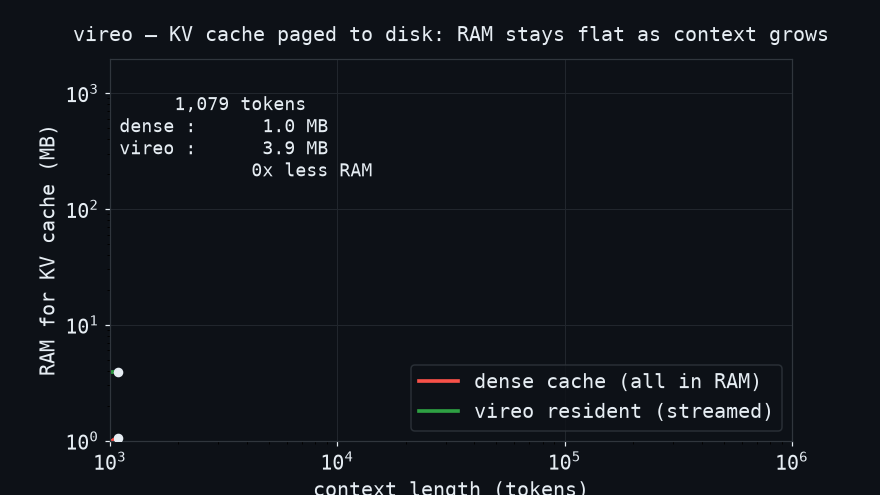

<h1 align="center">vireo</h1>
<p align="center"><b>Million-token context on the RAM you already have.</b></p>
<p align="center">A transformer's KV cache, paged to disk. Pure C, zero dependencies, CPU-first.</p>

<p align="center">
  <!-- TODO: drop a 20s asciinema/GIF here before launch. It is 80% of the stars. -->
  
</p>

---

A transformer that remembers a million tokens normally needs a huge KV cache in
RAM. But attention for any one token lands on only a few places: the first few
tokens (sinks), the recent window, and a handful of older tokens that actually
matter. **vireo keeps that hot set resident and streams the rest from your SSD**,
paging blocks in only when a query reaches for them. The context grows; the RAM
does not.

```
$ vireo bench 200000 topk
vireo bench  strategy=topk  context=200000 tokens
  resident RAM :    3.9 MB   (dense would need  195.3 MB  ->  50x less)
  cache hits   : 68.9%
  throughput   : 216874 tokens/sec
```

## Why it is correct, not just small

vireo ships a dense in-RAM reference and an out-of-core store behind the same
interface. With the exact (`all`) selection strategy, the out-of-core store is
**bit-for-bit identical** to dense — proven on every CI run by
`tests/test_kvstore_oracle.c`. The lossy strategies that make it fast are
measured *against* that oracle, so "50× less RAM" comes with a provable
baseline, not a vibe.

## Quickstart

```bash
git clone https://github.com/USER/vireo
cd vireo
make test      # builds + runs the oracle test (exact-match + RAM budget)
make bench     # streams a 200k-token context, prints the headline numbers
```

Needs a C compiler and `make`. Nothing else.

## Benchmark (synthetic, kv_dim=128, 64-token blocks, 64-block budget)

| context | strategy | resident RAM | dense RAM | ratio | cache hits |
|--------:|:---------|-------------:|----------:|------:|-----------:|
| 200k    | `all`    | 3.9 MB       | 195 MB    | 50×   | exact      |
| 200k    | `topk`   | 3.9 MB       | 195 MB    | 50×   | 68.9%      |
| 200k    | `recent` | 3.9 MB       | 195 MB    | 50×   | 100%       |

(Real-model numbers land with ROADMAP M1 — llama2.c integration. The synthetic
bench measures the pager itself.)

## How it works

See **[ARCHITECTURE.md](ARCHITECTURE.md)**. The whole project is one idea — an
out-of-core, lease-paged KV store with a pluggable block-selection strategy.
Adding a selection strategy is the easiest way to contribute: see
**[CONTRIBUTING.md](CONTRIBUTING.md)** and the open
**[good first issues](docs/good-first-issues.md)**.

## Status

Early. The pager and the correctness harness work today. Real-model inference,
prefetch, and SIMD are on the **[ROADMAP](ROADMAP.md)**. Stars and PRs welcome.

## License

MIT. Bundles a vendored copy of Andrej Karpathy's `llama2.c` (MIT) under
`baseline/` as the inference skeleton.
